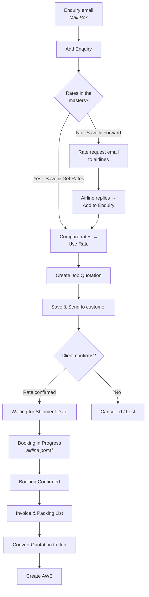

# Airsteam FF — User Guide

**Freight Forwarding SaaS · Direct Shipment (Air) · Phase 1 POC**
Based on *Airsteam FF – FRD – POC, Phase 01 (14-Oct-2026)*

This guide explains how to use the application from start to finish:

- receiving a customer's enquiry by email and entering it
- getting airline rates, from the rate masters or by requesting them from airlines
- building, previewing and sending the quotation
- following up for the shipment date and booking with the airline
- receiving the invoice and packing list, converting to a shipment job and issuing the AWB

---

## Contents

1. [Getting started](#1-getting-started)
2. [The flow at a glance](#2-the-flow-at-a-glance)
3. [Menu and navigation](#3-menu-and-navigation)
4. [Dashboard](#4-dashboard)
5. [Step-by-step: handling a shipment](#5-step-by-step-handling-a-shipment)
   - 5.1 [Receive the enquiry in the Mail Box](#51-receive-the-enquiry-in-the-mail-box)
   - 5.2 [Add the enquiry](#52-add-the-enquiry)
   - 5.3 [Save & Get Rates: compare rates from the masters](#53-save--get-rates-compare-rates-from-the-masters)
   - 5.4 [Save & Forward: request rates from airlines](#54-save--forward-request-rates-from-airlines)
   - 5.5 [Follow up: view requests and send reminders](#55-follow-up-view-requests-and-send-reminders)
   - 5.6 [Airline replies: Add to Enquiry](#56-airline-replies-add-to-enquiry)
   - 5.7 [Create the quotation](#57-create-the-quotation)
   - 5.8 [Preview and Send to Customer](#58-preview-and-send-to-customer)
   - 5.9 [Quotation Actions: status and reminders](#59-quotation-actions-status-and-reminders)
   - 5.10 [Confirm the shipment date](#510-confirm-the-shipment-date)
   - 5.11 [Book in the airline portal](#511-book-in-the-airline-portal)
   - 5.12 [Receive invoice and packing list](#512-receive-invoice-and-packing-list)
   - 5.13 [Convert quotation to job](#513-convert-quotation-to-job)
   - 5.14 [Create the AWB (Master / House)](#514-create-the-awb-master--house)
6. [The enquiry page](#6-the-enquiry-page)
7. [Lists: Enquiries, Quotations, Shipments](#7-lists-enquiries-quotations-shipments)
8. [Masters](#8-masters)
9. [Settings](#9-settings)
10. [Statuses](#10-statuses)
11. [Emails and client notifications](#11-emails-and-client-notifications)
12. [How the numbers are calculated](#12-how-the-numbers-are-calculated)
13. [Practice walkthroughs with the demo data](#13-practice-walkthroughs-with-the-demo-data)
14. [FRD coverage](#14-frd-coverage)
15. [POC limitations](#15-poc-limitations)
16. [FAQ and troubleshooting](#16-faq-and-troubleshooting)

---

## 1. Getting started

### Running the app

```bash
cd airsteam-ff
npm install      # first time only
npm run dev
```

Open **http://localhost:3000**.

### About the data

- The app opens with **demo data**: customers, agents, airlines, airports, airline rate sheets, five enquiries at different stages, and emails in the Mail Box.
- Everything you do is **saved in your browser**. It survives a refresh, but it isn't shared with other users or browsers.
- **Reset demo data** (bottom of the left menu) deletes your changes and restores the demo data.

### Reference numbers

| Document | Format | Example |
|---|---|---|
| Enquiry | `EQ: <prefix>-<number>-<year>` | `EQ: AIS-0005-2026` |
| Quotation | Same number as the enquiry | `QT: AIS-0005-2026` |
| Shipment job | Same number as the enquiry | `JOB: AIS-0005-2026` |

The prefix (`AIS`) is set in **Settings → Ref Number**.

---

## 2. The flow at a glance



The **enquiry page** shows a 9-step progress bar and a **Next action** panel that tells you what comes next and lets you do it.

| # | Progress step | Status when this step is active |
|---|---|---|
| 1 | Enquiry | (complete once saved) |
| 2 | Airline Rates | New Enquiry / Rate Requested |
| 3 | Quotation | Rate Received |
| 4 | Client Confirmation | Quote Confirmation Pending |
| 5 | Shipment Date | Waiting for Shipment Date |
| 6 | Booking | Booking in Progress |
| 7 | Invoice & Packing List | Booking Confirmed |
| 8 | Shipment Job | Docs Received |
| 9 | AWB | Job Created |

---

## 3. Menu and navigation

The menu follows the FRD:

| Group | Menu | Purpose |
|---|---|---|
| | **Dashboard** | Slides A–F, recent enquiries, mails needing action |
| | **Mail Box** | Inbox (customer enquiries and airline replies) and Sent. The yellow badge shows unread mails. |
| | **Client Notifications** | Log of WhatsApp / email updates sent to clients |
| **Jobs** | **Enquiries** | All enquiries |
| | **Quotations** | All quotations, with KPI cards |
| | **Shipments** | Jobs converted from confirmed quotations, and their AWBs |
| **Masters** | **Customers** | Shippers / consignees |
| | **Agents** | Forwarders, overseas agents, CHA, transporters |
| | **Airlines** | Airline emails, AWB prefix, airports served |
| | **Airline Rates** | Rate sheets used by *Get Rates* |
| | **Email Logs** | Every email sent from the app |
| **Settings** | **Settings** | Company, ref numbers, ports, currency, lists, users, quotation format, alerts, AWB template |

**Top bar:** current user and **+ Add Enquiry**.
On phones and narrow windows, open the menu with the **☰** button at the top left. It closes when you pick a page.

**Detail pages** (enquiry, quotation, shipment) have a **← back** link above the title.

---

## 4. Dashboard

Six **slides**, as defined in the FRD. Click a slide to open the Enquiries list filtered to its entries.

| Slide | Shows enquiries with status |
|---|---|
| **A · Enquiries Pending to Confirm**: received from the client, yet to revert with rates | New Enquiry, Rate Received |
| **B · Rates Yet to Receive**: forwarded to airlines, waiting for rates | Rate Requested |
| **C · Quotation Pending to Confirm**: sent to the client, waiting for confirmation | Quote Confirmation Pending |
| **D · Waiting for Shipment Date** | Waiting for Shipment Date |
| **E · Waiting for Booking Confirmation** | Booking in Progress |
| **F · Booking Confirmed** | Booking Confirmed, Docs Received, Job Created, AWB Created |

Below the slides:
- **Recent enquiries** with status and laps (time in the current status)
- **Mail Box: needs action**: customer enquiries and airline replies not yet linked to an enquiry
- **Recent client notifications**

---

## 5. Step-by-step: handling a shipment

### 5.1 Receive the enquiry in the Mail Box

1. Open **Mail Box** → **Inbox**.
2. Unread mails are **bold**. Each mail is tagged **Customer** or **Airline**. Mails already attached to an enquiry show **Linked**.
3. Click a mail to read it.
4. For a **customer** enquiry, click **+ Add to Enquiry**. A new enquiry opens, pre-filled from the mail.

> You can also start an enquiry without an email with **+ Add Enquiry** (top bar or Enquiries list).

### 5.2 Add the enquiry

**From an email**, a blue banner shows the source mail, and the app pre-fills what it can read:

- POL / POD (airport code like `COK`, or city name like `Kochi`), in the order mentioned
- gross weight (`180 kg`), which also sets the chargeable weight
- number and type of packages (`12 cartons`)
- dimensions (`55 x 45 x 40 cm`)
- commodity (a line starting `Commodity:`)
- customer, if the sender's email matches the customer master

If the sender isn't a known customer, click **Add sender as customer**.
Always review pre-filled values.

#### Section 1 · Office selection

| Field | Notes |
|---|---|
| Branch | From Settings → Lists |
| Financial Year | e.g. 2026-27 |

#### Section 2 · Customer and routing

| Field | Notes |
|---|---|
| Enquiry ID | System-generated (read-only) |
| Enquiry Date | Today by default, editable |
| Customer \* | From the customer master |
| Cargo Mode | Air / Sea |
| Shipment Mode | Export / Import |
| INCO Terms | FCA / FAS / FOB / CFR / CIF |
| Job Type | Forwarding / Clearing / Both |
| Origin (POL) \* | Shown as `KOCHI-COK-INDIA` (airport–code–country) |
| Destination (POD) \* | Shown as `COLOMBO-CMB-SRI LANKA`. Must differ from POL. |
| Route | e.g. Direct |

#### Section 3 · Cargo details

| Field | Notes |
|---|---|
| Commodity \* | Cargo description |
| Product Type | Perishable / Non-Perishable / Dangerous Cargo |
| Package Type | Cartons, Fiber board Boxes, Wooden Cases, … (Settings → Lists) |
| Gross Weight (kg) \* | |
| Chargeable Weight (kg) \* | **Pre-populated from gross weight.** If the volumetric weight is higher, a hint offers "Use it". |
| Unit Type | PCS, NOS, SET, DOZ, PRS, PAC, ROL |
| Number of Packages | |
| Length / Width / Height | cm, per package |
| Volume (CBM) | Automatic: packages × L × W × H ÷ 1,000,000 |
| Requested / Cargo-ready Date | |
| Clearance Place | From Settings → Lists |
| Transit Time | Free text |
| Airline Name(s) | Tick preferred airlines (only airlines serving the POL & POD are listed). They're pre-ticked when you forward. |
| Sales Person / Assigned (Pricing) Person | From Settings → Roles & Users |
| Remarks | |

#### Route insights (right-hand panel)

- **Airlines serving this route**
- **Rate availability**: green when rate sheets exist in the masters; amber "No rates updated in the masters…" when not
- **Previous shipments**: earlier enquiries with the **same destination**, **same POL & POD**, **same customer** and **same cargo**. Click one to open it.

#### Saving: three buttons

| Button | What happens |
|---|---|
| **Save Enquiry** | Saves with status **New Enquiry** and returns to the Enquiries list |
| **Save & Get Rates** | If rates exist in the masters for the POL & POD: saves and opens **Get Rates · Compare** ([5.3](#53-save--get-rates-compare-rates-from-the-masters)). If not: shows the message *"No rates updated in the masters…"* and **keeps you on the screen without saving**. |
| **Save & Forward** | Saves and opens **Select Airlines to Request Rates** ([5.4](#54-save--forward-request-rates-from-airlines)) |

The buttons stay disabled until all \* fields are filled and POL ≠ POD. A message next to the buttons lists exactly which fields are still missing.

### 5.3 Save & Get Rates: compare rates from the masters

The **Get Rates · Compare Airline Rate Sheets** pop-up shows:

- an enquiry summary (enquiry, customer, POL, POD, commodity, gross/chargeable weight, packages, dimensions)
- every valid rate for the POL & POD, from the rate masters **and** from airline replies to this enquiry

| Column | Meaning |
|---|---|
| Compare | Tick to include in the comparison |
| Airline / Currency | |
| Rate / kg, AWB Fee, Minimum Charge | From the rate sheet |
| Transit / Valid Until | |
| Estimated Total\* | Higher of (chargeable weight × rate/kg) or minimum charge, **plus** AWB fee |
| Source | Master, or Airline Reply |
| Action | **Use Rate** |

The cheapest estimated total is highlighted and tagged **Best**, and it's ticked by default.

- **Compare Selected** shows only the ticked rates, with how much more each costs than the best ("vs Best"). **Show All** returns to the full list.
- **Use Selected Rate & Create Quotation** (exactly one rate ticked) or **Use Rate** on a row creates the quotation and opens it ([5.7](#57-create-the-quotation)).

If there are no rates, the pop-up says so and offers **Save & Forward to airlines**.

You can open this pop-up any time with **Get Rates / Compare** in the enquiry's **Next action** panel (shown until a quotation is sent).

### 5.4 Save & Forward: request rates from airlines

1. **Select Airlines to Request Rates** lists airlines that serve the route, with their email from the Airline master. Airlines ticked on the enquiry are pre-selected; airlines already asked show *Already requested*.
2. Tick the airlines and click **Continue**.
3. The **Rate Request** email opens:
   - **To**: the selected airlines' emails (from the Airline master)
   - **CC / BCC**: optional
   - **Subject**: `Request for Air Freight Rate – KOCHI-COK-INDIA to COLOMBO-CMB-SRI LANKA [EQ: AIS-0006-2026]`
   - **Email Body**: enquiry reference, customer, shipment type, mode, POL, POD, commodity, packages, weights, dimensions/volume, requested date (editable)
   - **Company Signature** from Settings
4. Click **Send**.

Result:
- **One email per airline** (one rate per mail), each recorded in **Email Logs** and **Mail Box → Sent**
- The requests appear in **Forwarded Rate Requests** on the enquiry page
- Status becomes **Rate Requested**

> The enquiry reference in the subject is how an airline's reply is matched back to the enquiry ([5.6](#56-airline-replies-add-to-enquiry)).

### 5.5 Follow up: view requests and send reminders

The **Forwarded Rate Requests** card on the enquiry page lists every airline asked:

| Column | Shows |
|---|---|
| Airline / Email | |
| Sent | When the request went out |
| Reminders | How many, and when the last one was sent |
| Response | *Awaiting reply* · *Reply in Mail Box* (with an **Open reply** button) · *Rate received · INR x/kg* |

**Reminders:**
- **Remind all pending** (card header, shown when more than one airline hasn't replied) reminds **several airlines** at once. Pick them, then Continue.
- **Remind** on a row reminds one airline.

Either way the same mail box pop-up opens, with a reminder subject and body. Click **Send**.

> **Simulate reply** (demo only) drops a realistic rate reply from that airline into the Mail Box, so you can practise [5.6](#56-airline-replies-add-to-enquiry).

### 5.6 Airline replies: Add to Enquiry

1. Open **Mail Box** and the airline's reply (tagged **Airline**).
2. Click **+ Add to Enquiry**.
3. The pop-up:
   - **matches the enquiry** from the reference in the subject line (or lets you pick one)
   - shows the enquiry details
   - pre-fills the **rate quoted in the mail**: rate/kg, AWB fee, minimum charge, transit, valid until
4. Check the figures. Optionally tick **Also save to Airline Rate masters** to reuse the rate for future enquiries.
5. Click **Add to Enquiry**.

Result:
- the mail is linked to the enquiry
- the rate is stored against the enquiry (source *Airline Reply*) and appears in **Get Rates / Compare**
- the request row shows **Rate received**
- status becomes **Rate Received**

Next, open **Get Rates / Compare** and click **Use Rate**.

### 5.7 Create the quotation

**Create Job Quotation** opens with reference `QT: AIS-xxxx-yyyy` (the enquiry number) and status **Draft**.

**1. Enquiry Details** (auto-populated from the enquiry, read-only): Ref No, Shipment Mode, Type of Load, INCO Terms, Customer Name, Address Line, Kindly Attention, POL, POD, Cargo Description, Gross Weight, CBM, Product, Package Box Type, Transit Time, Route.

**2. Second section**

| Field | Notes |
|---|---|
| Cargo Dimension | e.g. `1 packages / 180 kgs (140 x 140 x 50 cm)` |
| Clearance Place | From Settings |
| Currency | Changing it fills in the ROE from Settings → Currency |
| ROE | Rate of exchange to INR |
| Carrier Name | Pre-set to the airline of the rate you used |
| Kindly Attention | Customer contact (from the customer master) |

**3. Rate entry: Airline Charges** (pre-filled from the rate)

| Particulars | Unit | Default |
|---|---|---|
| AIR FREIGHT CHARGES | Per kg × chargeable weight | Rate/kg (or **(MINIMUM)** per shipment, if the minimum charge is higher) |
| AIRWAY BILL FEES - AWA | Per shipment | AWB fee |

**Clearance / Agency Charges** (defaults from Settings → Quotation Format)

| Particulars | Unit | Default rate |
|---|---|---|
| CLEARANCE CHARGES | Per shipment | 3,500 |
| TERMINAL CHARGES-TSP | Per kg | 1.50 |
| LOADING/UNLOADING CHARGES | Per shipment | 800 |
| OVERTIME CHARGES | Per shipment | 0 |
| CERTIFICATE OF ORIGIN | Per shipment | 1,500 |

**Columns:** #, Particulars, Rate (FC), Mark Up, Unit, Qty, **Net Amount**, GST%, **Total GST**, **Total Amount**, Action (🗑 delete).
Use **+ Add** on a table header to add a line.

- Net Amount = (Rate + Mark Up) × Qty × ROE
- Total GST = Net Amount × GST% (default from Settings)
- Total Amount = Net Amount + Total GST
- **Grand Total** = all Airline + Agency Total Amounts, in INR. The green bar also shows airline, agency, GST and expected profit.

**Notes / Terms & Conditions**: default from Settings, editable.

**Buttons:** **Back to enquiry** (reads **Discard changes** when you have unsaved edits), **Preview**, **Save** (enabled when something changed), **Save & Send**.

> Every charge line needs a name. If a line's Particulars is empty, a message appears and **Save & Send** stays disabled until you name or delete it.

> Editing is possible while the status is *Draft* or *Quote Confirmation Pending*. After the client confirms, the quotation is locked.
> Using a different rate before sending replaces the draft. Once sent, it can't be replaced from Get Rates.

### 5.8 Preview and Send to Customer

**Preview** shows the customer-facing **Sales Quotation**:
company letterhead (Settings → General Setup), quotation no. and date, **To** (customer name, address, email, kind attention), **Shipment Details**, the charges table grouped by airline and agency (Particulars, Currency, Rate, Markup, Qty, Ex Rate, Net Amount, GST, Total), **Grand Total**, notes and signature.

Preview buttons: **Close**, **Print / Save PDF** (choose *Save as PDF* in the print dialog), **Send to Customer**.

**Send to Customer / Save & Send** opens **Compose Email**:
- **To**: picked automatically from the customer master
- **CC**: your company email
- **Subject**: `Quotation QT: AIS-0005-2026 – KOCHI-COK-INDIA to COLOMBO-CMB-SRI LANKA`
- **Body**: pre-written with the grand total, editable
- **Attachment**: `QT: AIS-0005-2026.pdf`
- Company signature

Click **Send**.

Result:
- quotation and enquiry status become **Quote Confirmation Pending**
- the mail is recorded in Email Logs
- a WhatsApp notification is sent to the client (if enabled in Settings → Alerts)

### 5.9 Quotation Actions: status and reminders

Open **Quotation Actions** (on the quotation screen) or **⋮ → Update status / Reminder** (Quotations list):

- **Update Status**: Draft · Quote Confirmation Pending · Waiting for Shipment Date · Booking in Progress · Booking Confirmed · Cancelled · Lost
- **Send Reminder**: opens Compose Email with a reminder to the customer (available after the quotation is sent)
- Shows when it was sent and how many reminders went out

**When the client confirms the rate** but not the date, set **Waiting for Shipment Date**. If the date is already known, you can go straight to **Booking in Progress**.

The enquiry status always follows the quotation status.

### 5.10 Confirm the shipment date

Status **Waiting for Shipment Date**: the enquiry's Next action asks you to follow up with the client.

1. Enter the **Confirmed shipment date**.
2. Click **Confirm shipment date**.

The status becomes **Booking in Progress**.

### 5.11 Book in the airline portal

Status **Booking in Progress**: the Next action panel shows:

- **Open <carrier> portal**: the airline's booking portal (from the Airline master), in a new tab
- **Flight routings (Flightradar24)** and **Flights POL → POD (Skyscanner)**: free sources to check flight routings

After booking in the portal, enter the **Booking reference**, **Flight no.** (pre-filled with the airline code) and **Flight date** (pre-filled with the shipment date). Click **Booking Confirmed**.

Result: status **Booking Confirmed**, and the client gets a WhatsApp notification asking for the invoice and packing list.

### 5.12 Receive invoice and packing list

Enter the **Commercial invoice no.** and **Invoice value**, tick **Packing list received**, then click **Save documents**.
Status becomes **Docs Received**.

### 5.13 Convert quotation to job

Click **Convert Quotation to Job**. A shipment job (`JOB: AIS-xxxx-yyyy`) is created, the status becomes **Job Created**, and the shipment page opens.

### 5.14 Create the AWB (Master / House)

The shipment page shows a summary and the **Create Air Waybill (AWB)** form, pre-filled from the enquiry, booking and customer.

| Field | Notes |
|---|---|
| AWB type | **Master AWB (MAWB)**: issued by the airline. **House AWB (HAWB)**: issued by the agent for shared cargo. |
| AWB number | MAWB: airline's 3-digit prefix + 8-digit serial (suggested; replace with the real number) |
| Flight no. / date | From the booking |
| Shipper | Customer name and address |
| Consignee \* | Required |
| Pieces, gross & chargeable weight, rate class | From the enquiry |
| Nature & quantity of goods | Commodity, packages, dimensions |
| Handling information | Pre-filled for perishable / dangerous cargo |
| Issue date | |

Click **Create AWB**. The printable waybill appears and the status becomes **AWB Created**. The client gets an email notification (if enabled). **Print AWB** prints or saves it as PDF.

---

## 6. The enquiry page

| Area | Contents |
|---|---|
| Header buttons | **Edit Enquiry**, **Change Status**, **Notify Client** (Get Rates / Compare and Save & Forward are in the Next action panel while rates are being collected) |
| Progress bar | The 9 steps (or a red note if the enquiry is Cancelled / Lost) |
| Next action | The action for the current status (see [section 10](#10-statuses)) |
| Enquiry Details | Every field from the form, including volume (CBM) |
| Forwarded Rate Requests | Airlines asked, reminders, responses ([5.5](#55-follow-up-view-requests-and-send-reminders)) |
| Shipment Record | Quotation, grand total, shipment date, booking, flight, invoice, packing list |
| Sidebar | Source email · Route insights · **Activity** (every email and client notification for this enquiry, newest first) |

**Change Status** lets you set any status manually (for example *Cancelled* or *Lost*, or to reopen an enquiry).
**Edit Enquiry** opens the same form with the current values. Save Changes keeps the status.

---

## 7. Lists: Enquiries, Quotations, Shipments

### Enquiries

Columns: **Enquiry No · Date · Type | Customer Name | Route (POL → POD) | Status | Status Date / Laps | ⋮**

- The enquiry number links to the enquiry. The date, shipment mode and cargo mode are shown under it.
- Route shows airport codes (e.g. `COK → FRA`) with the route type underneath. Hover a code to see the full `KOCHI-COK-INDIA` name.
- **⋮** opens the row actions: **View**, **Edit**, **Change Status**.

- Filter chips match the dashboard slides.
- Search by enquiry number, customer, port, commodity or status.

### Quotations

- **KPI cards**: Total Quotations · Confirmation Pending · Booking in Progress · Total Quoted Value (live quotations, INR)
- Columns: **Ref No · Date · Type | Customer Name | Route (POL → POD) | Grand Total | Status | Laps | ⋮**
  - **⋮ → View**: quotation preview
  - **⋮ → Edit** (or click the ref): Create Job Quotation screen
  - **Update status / Reminder**: Quotation Actions
- **+ New Quotation**: pick an enquiry without a quotation, then go to Get Rates.

### Shipments

Job no., date, customer, route, carrier, flight, and AWB (MAWB/HAWB number, or *Pending*).

---

## 8. Masters

| Master | Fields | Used for |
|---|---|---|
| **Customers** | Name, address, kindly attention, email, phone/WhatsApp | Enquiry customer, quotation "To", quotation email, notifications |
| **Agents** | Type (Forwarder / Overseas Agent / CHA / Transporter), name, contact, email, phone, city, country | Reference list (tabs filter by type) |
| **Airlines** | Name, IATA code, AWB prefix, rate-request email, booking portal URL, airports served | Airlines serving a route, rate-request emails, carrier dropdown, MAWB prefix, portal link |
| **Airline Rates** | Airline, POL, POD, currency, rate/kg, AWB fee, minimum charge, transit, valid until | Save & Get Rates / Compare |
| **Email Logs** | Every sent mail: type, to/cc/bcc, subject, body, attachments, enquiry | Audit trail (click a row to read the mail) |

**Airline Rates** is grouped by route. The lowest valid rate/kg is tagged **Lowest/kg**; expired rates are greyed out and tagged **Expired**, and never offered in Get Rates.

> An airline appears for a route only if **both** the POL and the POD are in its *airports served*.

---

## 9. Settings

| Tab | What you set |
|---|---|
| **General Setup** | Company name, address, phone, email, website, GSTIN, PAN, email signature (letterhead and signature on all mails) |
| **Ref Number** | Prefix for EQ / QT / JOB numbers, with a live preview |
| **Port & Country** | Global airport list (code, name, country), shown as `KOCHI-COK-INDIA` |
| **Currency** | Currencies and ROE to INR (used by quotations) |
| **Lists** | Branches, financial years, clearance places, package types, unit types (one per line) |
| **Roles & Users** | Users and roles (Sales / Pricing / Operations / Admin), used for Sales and Pricing person |
| **Quotation Format** | Default GST %, default agency charges, default terms & conditions |
| **Alerts & Notifications** | Turn client notifications on/off for quotation sent, booking confirmed, AWB issued; reminder intervals |
| **AWB Template** | Explains Master vs House AWB numbering |

Click **Save changes** to apply your edits. "You have unsaved changes" appears until you do.
To keep the app usable, Settings won't save an empty reference prefix, an empty dropdown list, or a list with no users or airports. The reason is shown next to the button.

---

## 10. Statuses

| Status | Meaning | Next action on the enquiry page |
|---|---|---|
| **New Enquiry** | Saved | Get Rates / Compare, or Save & Forward |
| **Rate Requested** | Forwarded to airlines | Wait for replies → Add to Enquiry; send reminders |
| **Rate Received** | An airline rate was added | Get Rates / Compare → Use Rate |
| **Quote Confirmation Pending** | Quotation emailed | Quotation Actions: update status / send reminder |
| **Waiting for Shipment Date** | Rate confirmed, date pending | Confirm shipment date |
| **Booking in Progress** | Booking in the airline portal | Booking ref + flight → Booking Confirmed |
| **Booking Confirmed** | Airline confirmed | Invoice & packing list |
| **Docs Received** | Documents received | Convert Quotation to Job |
| **Job Created** | Shipment job open | Create AWB |
| **AWB Created** | Complete | View shipment |
| **Cancelled / Lost** | Closed | Change Status to reopen |

---

## 11. Emails and client notifications

### Emails sent from the app

| Email | Sent from | To |
|---|---|---|
| Rate Request | Save & Forward | Each selected airline (one mail per airline) |
| Rate Reminder | Send Reminder / Remind | Selected airlines |
| Quotation | Save & Send / Send to Customer | Customer (from master), PDF attached |
| Quotation Reminder | Quotation Actions → Send Reminder | Customer |

Every mail is recorded in **Masters → Email Logs** and **Mail Box → Sent**, and listed on the enquiry page.

### Instant client notifications

| Event | Channel |
|---|---|
| Quotation emailed | WhatsApp |
| Booking confirmed | WhatsApp (asks for invoice & packing list) |
| AWB issued | Email |
| Manual: **Notify Client** on the enquiry page | WhatsApp or Email, any message |

Automatic notifications can be switched off in **Settings → Alerts & Notifications**. Everything sent is listed under **Client Notifications**.

---

## 12. How the numbers are calculated

| Value | Formula | Example |
|---|---|---|
| Volume (CBM) | packages × L × W × H (cm) ÷ 1,000,000 | 1 × 140 × 140 × 50 ÷ 1,000,000 = **0.9800** |
| Volumetric weight (kg) | packages × L × W × H ÷ 6000 | 1 × 140 × 140 × 50 ÷ 6000 = **163.33** |
| Chargeable weight | Gross weight by default; can be set to the volumetric weight | 180 kg |
| Estimated total (rate compare) | max(chargeable × rate/kg, minimum charge) + AWB fee | max(0 × 185, 4,500) + 1,250 = **5,750** |
| Net Amount | (Rate + Mark Up) × Qty × ROE | (185 + 0) × 1 × 1 = **185.00** |
| Total GST | Net Amount × GST% | 185 × 18% = **33.30** |
| Total Amount | Net Amount + Total GST | **218.30** |
| Grand Total | Σ Total Amount (airline + agency) | |
| Expected profit | Σ Mark Up × Qty × ROE | |

---

## 13. Practice walkthroughs with the demo data

Click **Reset demo data** first.

### Demo enquiries

| Ref | Customer | Route | Status |
|---|---|---|---|
| EQ: AIS-0001 | ABC Exporters | COK → DXB | Job Created (AWB pending) |
| EQ: AIS-0002 | ABC Exporters | COK → LHR | Quote Confirmation Pending |
| EQ: AIS-0003 | Malabar Spice Traders | COK → FRA | Rate Requested (Emirates has replied in the Mail Box) |
| EQ: AIS-0004 | Coastal Seafoods | COK → DXB | New Enquiry (rates in masters) |
| EQ: AIS-0005 | Kerala Handicrafts | COK → CMB | Waiting for Shipment Date |

### A — Rates available in the masters (email → quotation)

1. **Mail Box** → *Anitha Nair – Rate request: 12 cartons handicrafts Kochi to Colombo* → **+ Add to Enquiry**.
2. Customer, KOCHI-COK-INDIA → COLOMBO-CMB-SRI LANKA, 12 cartons, 180 kg, dimensions and commodity are pre-filled. Route insights show three rate sheets.
3. Click **Save & Get Rates**. The compare pop-up shows Air India, Emirates and SriLankan.
4. Click **Use Rate** on the **Best** row. Check the charges, add a mark-up and click **Save**.
5. **Preview**, then **Send to Customer** and **Send**. Status: *Quote Confirmation Pending*.
6. **Quotation Actions** → *Waiting for Shipment Date* → **Update Status**.
7. Go back to the enquiry, confirm a shipment date, then enter the booking (ref `UL-4471`, flight `UL 166`) and click **Booking Confirmed**.
8. Enter invoice `KHC/091`, tick the packing list and click **Save documents**. Then **Convert Quotation to Job**, enter a consignee and click **Create AWB**.

### B — No rates: forward to airlines (the "No" path)

1. **Mail Box** → *Vikram Shah – textiles to New York* → **+ Add to Enquiry**.
2. Click **Add sender as customer**, then enter commodity `Home textiles`.
3. Click **Save & Get Rates**. The message *"No rates updated in the masters for BOM → JFK"* appears and you stay on the form.
4. Click **Save & Forward**, tick two airlines, click **Continue**, review the Rate Request email and click **Send**. Status: *Rate Requested*.
5. On the enquiry, click **Remind** for one airline and **Send**.
6. Click **Simulate reply** on an airline, then click the *Reply in Mail Box* link.
7. **+ Add to Enquiry** → check the rate → **Add to Enquiry**. Status: *Rate Received*.
8. **Get Rates / Compare** → **Use Rate**, then continue as in A.

### C — Airline reply already waiting

1. **Mail Box** → *Emirates SkyCargo – RE: Request for Air Freight Rate … [EQ: AIS-0003-2026]*.
2. **+ Add to Enquiry**. The enquiry is matched from the subject and INR 410/kg is pre-filled. Tick **Also save to Airline Rate masters** and click **Add to Enquiry**.
3. Open EQ: AIS-0003 → **Get Rates / Compare** → **Use Rate**.

### D — Finish in-progress work

- **EQ: AIS-0002**: open its quotation → **Quotation Actions** → **Send Reminder**, then set *Waiting for Shipment Date*.
- **EQ: AIS-0005**: confirm the shipment date and book.
- **EQ: AIS-0001**: open the shipment → choose Master or House AWB → **Create AWB**.

---

## 14. FRD coverage

| FRD item | Where |
|---|---|
| Menu: Dashboard, Mail Box, Jobs (Enquiry, Quotation, Shipments), Masters, Settings | Left menu ([3](#3-menu-and-navigation)) |
| Dashboard slides A–F, clickable | Dashboard ([4](#4-dashboard)) |
| Indication of previous shipments to the same destination | Route insights ([5.2](#52-add-the-enquiry)) |
| Enquiry list columns incl. Status Date, Laps, View/Edit/Change Status | Enquiries ([7](#7-lists-enquiries-quotations-shipments)) |
| Enquiry Sections 1–3, all fields | Add Enquiry ([5.2](#52-add-the-enquiry)) |
| Save → "New Enquiry"; no rates → message, stay on screen | [5.2](#52-add-the-enquiry) |
| Save & Forward → Select Airlines → Rate Request email; one rate per mail | [5.4](#54-save--forward-request-rates-from-airlines) |
| See forwarded requests (multiple airlines); status "Rate Requested" | [5.5](#55-follow-up-view-requests-and-send-reminders) |
| Send Reminder to multiple airlines via mail box pop-up | [5.5](#55-follow-up-view-requests-and-send-reminders) |
| Airline reply stored in Mail Box; "Add to Enquiry" linked by reference; "Rate Received" | [5.6](#56-airline-replies-add-to-enquiry) |
| Save & Get Rates → compare rate sheets → Use Selected Rate & Create Quotation | [5.3](#53-save--get-rates-compare-rates-from-the-masters) |
| Create Job Quotation: banner fields, second section, rate entry, GST, totals, T&C | [5.7](#57-create-the-quotation) |
| Enquiry ID becomes Quotation ID | [1](#reference-numbers) |
| Save, Save & Send, Preview, PDF, Send to Customer (email from master, PDF attached) | [5.8](#58-preview-and-send-to-customer) |
| Status "Quote Confirmation Pending"; reminders from quotation; Quotation Actions statuses | [5.9](#59-quotation-actions-status-and-reminders) |
| Quotation list with KPI cards | [7](#7-lists-enquiries-quotations-shipments) |
| Shipment date confirmed → "Booking in Progress"; airline portal; flight routing sources | [5.10](#510-confirm-the-shipment-date)–[5.11](#511-book-in-the-airline-portal) |
| Booking confirmed → invoice & packing list from client | [5.12](#512-receive-invoice-and-packing-list) |
| Master AWB (airline) / House AWB (agent, shared cargo) | [5.14](#514-create-the-awb-master--house) |
| Masters: Forwarders, Overseas Agents, CHA, Shipper, Airlines, Transporter, Email Logs | [8](#8-masters) |
| Settings: company/general, roles & users, notifications, alerts & reminders, ref number, port & country, currency, AWB template, quotation format | [9](#9-settings) |

---

## 15. POC limitations

| Area | In this POC | Planned |
|---|---|---|
| Data | Stored in the browser (per user, per browser) | Shared database, multi-user |
| Login / roles | Users list only, no login | Authentication and role permissions |
| Mail Box | Demo mails; airline replies can be simulated | Live mailbox integration (read and send) |
| Emails / WhatsApp | Recorded in Email Logs / Client Notifications, not delivered | Real delivery |
| Quotation PDF | Browser Print → Save as PDF; attachment is named in the mail | Generated PDF attached |
| Airline booking | Opens the airline portal and flight-search sites | Portal / API integration where available |
| AWB template | Fixed layout | Configurable template |
| Sea freight | Selectable, but the flow is built for Air | Sea-specific flow |

---

## 16. FAQ and troubleshooting

**Save buttons are greyed out.**
Fill all \* fields (customer, POL, POD, commodity, gross weight, chargeable weight) and make POL different from POD.

**"Save & Get Rates" says there are no rates.**
No valid rate sheet exists for that exact POL & POD. Add one in **Masters → Airline Rates**, or use **Save & Forward** to ask airlines.

**An airline isn't offered for my route.**
In **Masters → Airlines**, its *airports served* must include both POL and POD.

**Add to Enquiry didn't find the enquiry.**
The airline's reply subject must contain the enquiry reference (e.g. `EQ: AIS-0003-2026`). Otherwise pick the enquiry from the dropdown.

**"Use Selected Rate & Create Quotation" is disabled.**
Tick exactly one rate, or use **Use Rate** on a row. If a quotation has already been sent for the enquiry, it can't be replaced.

**I can't edit the quotation.**
Quotations lock once the status moves past *Quote Confirmation Pending*.

**My data disappeared.**
Data lives in the browser you used. A different browser, a private window or clearing site data starts again from the demo data.
